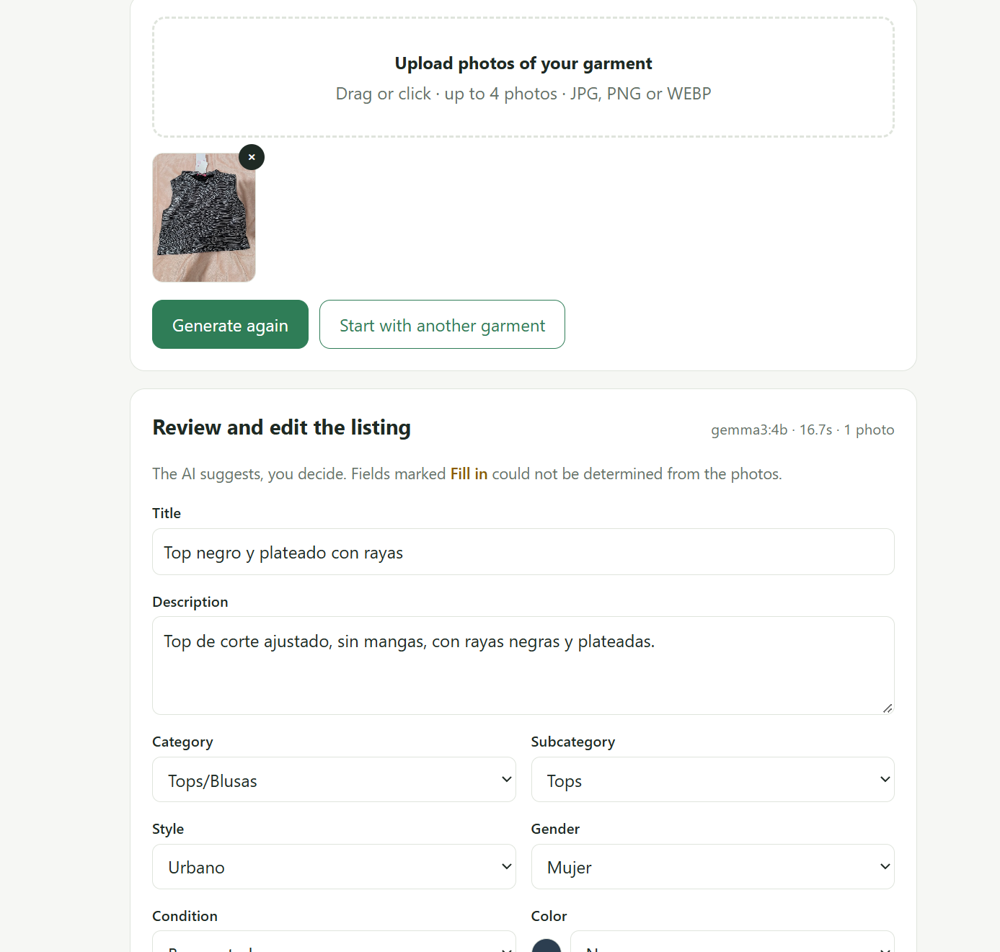
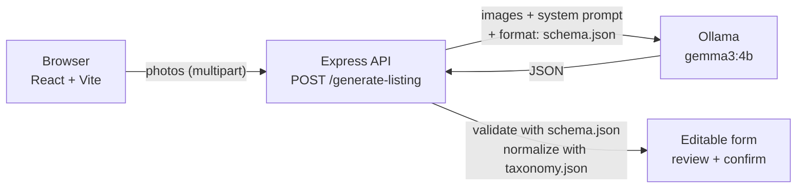

# Mano en Mano · AI Listing Generator

> Upload 1 to 4 photos of a secondhand garment and get an editable product listing with 12 fields, generated locally by an open-weight vision model.

[](LICENSE)

-4285F4)


Built for the **Hacktoberfest Open-Source AI Challenge, Week 2: Side Hustle** · Read the post on DEV: [POST_URL](https://dev.to/noraprogramadora/snap-a-photo-get-a-listing-a-local-gemma-3-listing-generator-for-secondhand-clothes-c17) · Demo video: [VIDEO_URL](https://www.youtube.com/watch?v=u4IuFxRxIdQ)



---

## The problem

[Mano en Mano](https://manoenmano.mx) is a circular-economy marketplace for secondhand clothing. Every seller has to write a listing for each garment: title, description, category, condition, size... For people selling dozens of items, that is slow, repetitive work, and it is one of the main reasons secondhand clothes never get listed.

## What it does

1. The seller uploads 1 to 4 photos of one garment.
2. Gemma 3 (`gemma3:4b`), running locally in Ollama, analyzes the images.
3. The app returns a structured listing that **pre-fills an editable form**.
4. The seller reviews it, fixes what is wrong and confirms.

The model suggests; the seller always has the final word.

### Fields generated

The output follows the Mano en Mano `Product` model, so it can pre-fill the listing form directly.

| Field | Type | Notes |
|---|---|---|
| `name` | string | Short title (max 60 chars): garment type + color + main feature. No invented phrases |
| `description` | string | 1–2 sentences, only what is visible in the photos |
| `category` | enum | One of 16 marketplace categories (e.g. `Tops/Blusas`, `Vestidos`, `Calzado`) |
| `subcategory` | enum | Must belong to the chosen category (validated in code) |
| `style` | enum | `Vintage`, `Casual`, `Formal`, `Boho`, `Urbano`, `Streetwear` |
| `gender` | enum | `Mujer`, `Hombre`, `Unisex`, `Sin género`, `Neutro`, `Infantil/Bebé` |
| `brand` | string | Only if a label or logo is clearly visible |
| `materials` | array | `Algodón`, `Lana`, `Poliéster`, `Mezclilla`, `Seda`, `Cuero/Sintético`, `Lino`, `Otro`. Only if a composition label is visible; otherwise empty |
| `condition` | enum | `Nuevo con etiqueta`, `Como nuevo`, `Buen estado`, `Con detalles/Usado` |
| `color` | enum | Main color from a 13-color palette (mapped to hex in code) |
| `size` | enum | Letter, numeric and baby/kids sizes. Only if the size label is visible |
| `productDefects` | string | Visible defects only (stains, pilling, holes, wear); empty if none |

All allowed values live in [`schema.json`](schema.json) and [`taxonomy.json`](taxonomy.json). The UI is in English; field values are in Spanish, the language of the marketplace.

Fields the AI deliberately does **not** fill: `price`, `isOriginal` (authenticity cannot be verified from a photo), `productHistory`, `deliveryAddress`, `openCategories`.

## How it works



- **Structured output:** [`schema.json`](schema.json) is passed in Ollama's `format` parameter, so the model must return JSON with exactly those 12 fields and only the allowed values. The server checks the response against the schema again before using it.
- **`unknown` → `null`:** when something cannot be seen in the photos, the model answers `unknown`. The server turns it into `null`, and the UI marks that field as **Fill in** for the seller.
- **Category/subcategory pair:** the schema alone allows any subcategory, so the server checks the pair against [`taxonomy.json`](taxonomy.json). If they do not match, it clears the subcategory and returns a warning.
- **Color to hex:** the color name is mapped to its hex value from `taxonomy.json` (`colorHex`) and shown as a swatch.
- **Edit count:** on the confirmation screen the UI compares the final listing with the AI's proposal and shows how many of the 12 fields the seller changed, and which ones.

## Why open-source AI

- **Privacy:** sellers' photos are processed on the machine and never sent to a third-party server.
- **Cost:** no per-request fees. For a marketplace where each garment is worth little, cost per listing has to be close to zero.
- **Control:** I can change the model, adjust the prompt and the JSON schema, and eventually fine-tune on real marketplace data.
- **No lock-in:** swapping Gemma for another open-weight model in Ollama is one environment variable (`OLLAMA_MODEL`).

## Tech stack

- **Model:** [Gemma 3](https://ai.google.dev/gemma) 4B (vision-capable, open weights)
- **Inference:** [Ollama](https://ollama.com), running locally
- **Backend:** Node.js + TypeScript, Express 5, multer (run with `tsx`)
- **Frontend:** React 19 + Vite + TypeScript
- **Structured output:** JSON schema passed to Ollama's `format` parameter

## Getting started

### Prerequisites

- [Ollama](https://ollama.com/download) installed and running (a version that supports a JSON schema in `format`, 0.5 or newer)
- Node.js 20+

### 1. Download the model

```bash
ollama pull gemma3:4b
```

### 2. Start the API (terminal 1, from the repo root)

```bash
git clone https://github.com/nora-programadora/mano-en-mano-fichas-ia.git
cd mano-en-mano-fichas-ia
npm install
npm run dev:server
```

The API listens on http://localhost:3001. Check that it can reach Ollama and the model:

```bash
curl http://localhost:3001/health
# {"ok":true,"model":"gemma3:4b","ollama":{"reachable":true,"modelAvailable":true}}
```

### 3. Start the web UI (terminal 2, from the repo root)

```bash
cd web && npm install && npm run dev
```

Open http://localhost:5173. In development, Vite forwards `/api/*` to the API on port 3001.

### Running on WSL with Ollama on Windows

If you run the project inside WSL and Ollama is installed on Windows, WSL needs to reach Ollama at `localhost:11434`.

**Option A: mirrored networking (recommended).** Add this to `%UserProfile%\.wslconfig` on Windows:

```ini
[wsl2]
networkingMode=mirrored
```

Then run `wsl --shutdown` in PowerShell and open WSL again. `localhost` now points to Windows, and the default `OLLAMA_URL` works without changes.

**Option B: point `OLLAMA_URL` at the Windows host.** With the default NAT networking, Ollama must listen on all interfaces (set the Windows environment variable `OLLAMA_HOST=0.0.0.0` and restart Ollama; the Windows firewall may ask for permission). Then, from WSL:

```bash
OLLAMA_URL="http://$(ip route show default | awk '{print $3}'):11434" npm run dev:server
```

### Configuration

Environment variables read by [`server/config.ts`](server/config.ts) and [`server/index.ts`](server/index.ts):

| Variable | Default | Description |
|---|---|---|
| `OLLAMA_URL` | `http://localhost:11434` | Where Ollama is running |
| `OLLAMA_MODEL` | `gemma3:4b` | Model used for analysis |
| `PORT` | `3001` | API port |
| `OLLAMA_TIMEOUT_MS` | `180000` | Max time to wait for the model, in ms |
| `CORS_ORIGIN` | any origin | Allowed CORS origin for the API |

The web UI reads `VITE_API_URL` (default `/api`, the Vite proxy) if you serve it without the dev server.

## API

### `POST /generate-listing`

`multipart/form-data` with the field **`photos`**: 1 to 4 images (JPG, PNG or WEBP), max 8 MB each. All photos must be of the same garment.

```bash
curl -F "photos=@front.jpg" -F "photos=@label.jpg" http://localhost:3001/generate-listing
```

Example response. The listing is real model output from the batch test in `results/`, passed through the server's validation and normalization:

```json
{
  "listing": {
    "name": "Top negro con volantes",
    "description": "Top negro con volantes en el escote y la parte inferior. Tiene un cierre con cordón en la espalda.",
    "category": "Tops/Blusas",
    "subcategory": "Blusas",
    "style": "Casual",
    "gender": "Mujer",
    "brand": null,
    "materials": [],
    "condition": "Con detalles/Usado",
    "color": "Negro",
    "colorHex": "#2C3E50",
    "size": null,
    "productDefects": "Volantes deshilachados en algunos lugares, cordón desgastado en el cierre."
  },
  "warnings": [],
  "missingFields": ["brand", "size"],
  "meta": { "model": "gemma3:4b", "photos": 1, "seconds": 22.4 }
}
```

- `warnings`: changes the server made (e.g. a subcategory that does not belong to the category was cleared, or the title was cut to 60 characters).
- `missingFields`: fields the model could not determine and the seller must fill in.

Errors return `{ "error": "..." }` with status `400` (no valid photos, too many or too large), `422` (the model output was not valid JSON or did not match the schema), `502` (Ollama not reachable or returned an error) or `504` (the model took longer than `OLLAMA_TIMEOUT_MS`).

### `GET /health`

```json
{ "ok": true, "model": "gemma3:4b", "ollama": { "reachable": true, "modelAvailable": true } }
```

## Testing it

[`scripts/test-garments.mjs`](scripts/test-garments.mjs) runs the same prompt and schema over a folder of photos (one photo = one garment), without the API or the UI. It only needs Ollama and Node 20+.

```bash
mkdir private-photos          # put your own .jpg/.png/.webp photos here
npm run test:garments         # same as: node scripts/test-garments.mjs private-photos
OLLAMA_MODEL=gemma3:12b node scripts/test-garments.mjs private-photos   # try another model
```

It prints one line per photo and writes two files to `results/`, named `<model>_<timestamp>`:

- `.json`: the raw model output, time per photo and any issues (subcategory not in the category, color outside the palette).
- `.csv`: one row per photo with all fields, plus an empty `notas_correcto_o_error` column to annotate each result by hand.

## Results

So far there is one batch run in `results/`: `gemma3-4b_2026-10-17-05-28`, 10 garments, one photo each, `gemma3:4b` at temperature 0.

- **Time per garment:** 16.9 s on average (min 14.9 s, max 22.4 s) 
- **Schema:** all 10 responses were valid JSON and matched the schema; no subcategory/category mismatches.

**What went wrong with the first prompt.** In that run:

- `condition` was `Con detalles/Usado` for all 10 garments.
- `productDefects` was the literal string `unknown` in 8 of 10.
- Two Nike sports tops were labeled `Boho`.
- Khaki trousers came out as `Jeans` and `Marrón`.
- A pair of trousers was described with "manga larga" (long sleeves).

The current [`prompts/system.txt`](prompts/system.txt) adds explicit rules for each case: when to use each `condition` value (only `Con detalles/Usado` if a concrete defect is visible and described), an empty string instead of `unknown` in `productDefects`, no `Boho` for sportswear, beige/khaki/cream as `Beige` and `Marrón` only for dark browns, `Jeans` only for denim, and no sleeves or necklines in descriptions of trousers.


## Limitations

- **Condition is hard to judge from a photo.** Wear, small stains or pilling often do not show up, so `condition` is always editable and confirmed by the seller.
- **The 4B model makes mistakes:** wrong subcategory, color or style, as the results above show. The form exists so the seller can correct them.
- **Speed:** 15 to 25 seconds per garment on my laptop.
- **Small test set:** tested so far with only a few garments (10 in the batch run).
- Quality depends on photo lighting and background.

## Roadmap

- [x] Proof of concept: photo → JSON with Gemma 3 via Ollama
- [x] Closed lists for every field (`schema.json`, `taxonomy.json`)
- [x] Structured output enforced with Ollama's `format` parameter
- [x] `POST /generate-listing` endpoint with validation and normalization
- [x] React UI with an editable pre-filled form
- [x] Batch test script (`scripts/test-garments.mjs`)
- [x] Comparison of `gemma3:4b` vs `gemma3:12b` on real garments
- [x] Test with real Mano en Mano sellers
- [ ] Garment measurements in cm (flat-lay photo + reference marker)
- [ ] Fine-tuning with marketplace data
- [ ] Integration into the Mano en Mano app

## Project structure

```
.
├── LICENSE
├── README.md
├── package.json           # API scripts and dependencies
├── tsconfig.json
├── schema.json            # JSON schema sent to Ollama's `format` parameter
├── taxonomy.json          # Categories, subcategories, colors (with hex), sizes, materials...
├── prompts/
│   └── system.txt         # System prompt (Spanish)
├── server/                # Express API
│   ├── index.ts           # POST /generate-listing, GET /health
│   ├── config.ts          # Env vars, loads schema, taxonomy and prompt
│   ├── ollama.ts          # Call to Ollama's /api/chat
│   └── listing.ts         # Schema validation and normalization
├── scripts/
│   └── test-garments.mjs  # Batch test over a folder of photos
└── web/                   # React + Vite UI (own package.json)
    ├── index.html
    ├── vite.config.ts     # Proxy /api → localhost:3001
    └── src/
        ├── App.tsx
        ├── PhotoPicker.tsx
        ├── ListingForm.tsx
        ├── api.ts
        ├── types.ts
        └── styles.css
```

## Privacy

Photos never leave your machine: the browser sends them to the local API, and the API sends them only to Ollama on `localhost` (or the `OLLAMA_URL` you set). Nothing is stored on disk by the API. The `private-photos/` folder used for testing is in `.gitignore` and is not uploaded to the repo.

## License

[MIT](LICENSE)

## Author

**Nora Aguirre**, founder of [Mano en Mano](https://manoenmano.mx)
